# CloverVolt

CloverVolt is an EV charging product for drivers in Pakistan and for the people who run the chargers.

A driver opens the phone app, finds a station, books a connector, starts a charge, and pays. An operator opens the web console and runs the network: stations, prices, live chargers, bookings, wallets, and partners.

This repository is the case study. It does not contain the application source.

Names, emails, and phone numbers on these screens are sample values from the design, not live customer records.

## Customer app — charging flow

Only the screens that sit on the main path are shown here.

  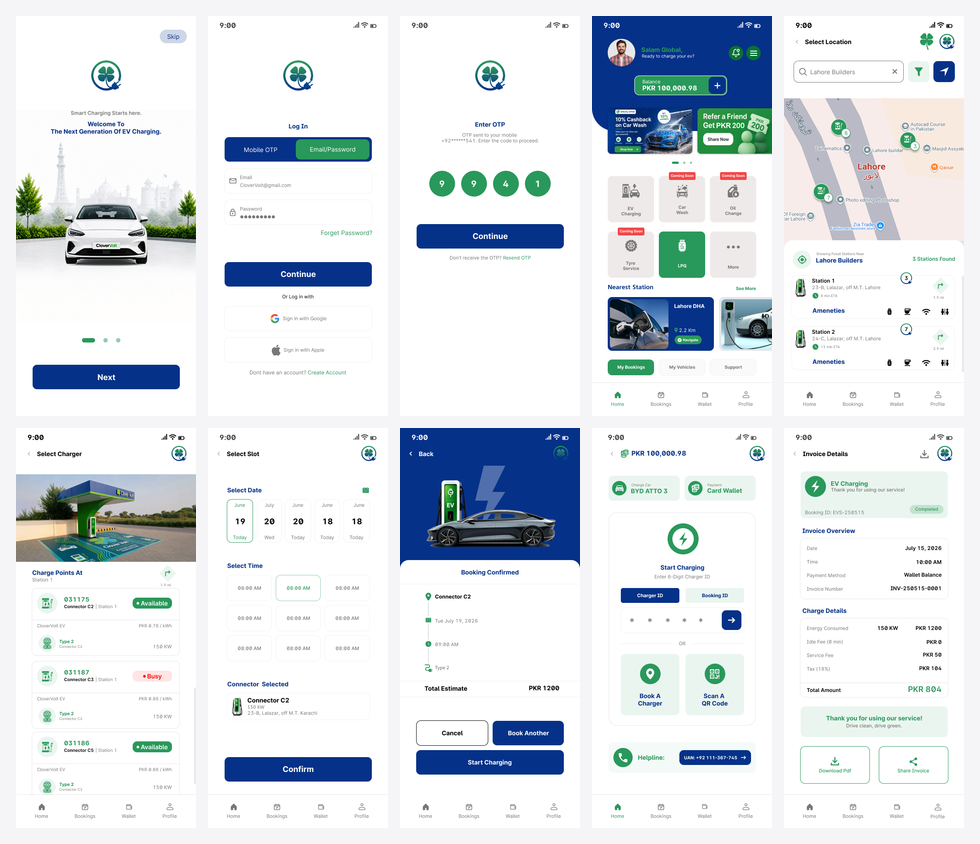

### Auth and home

  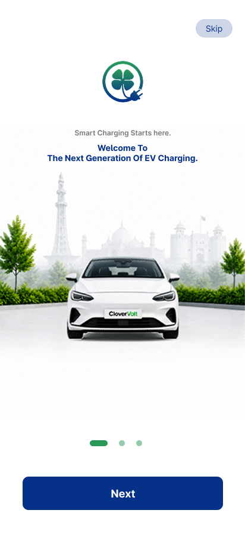
  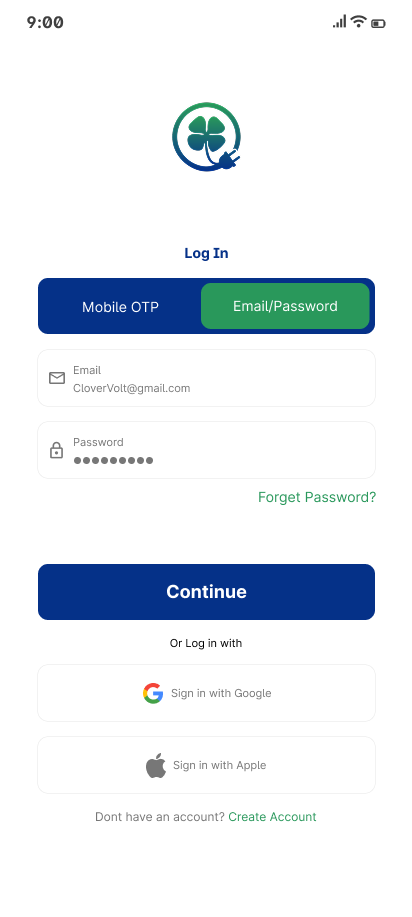
  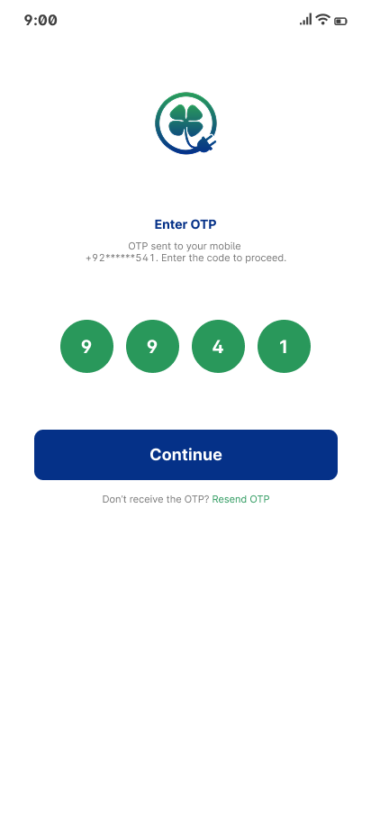
  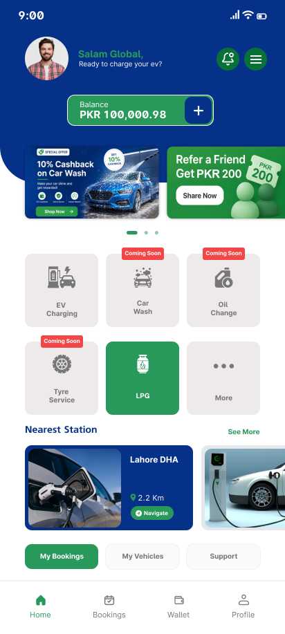

### Find, book, charge, pay

  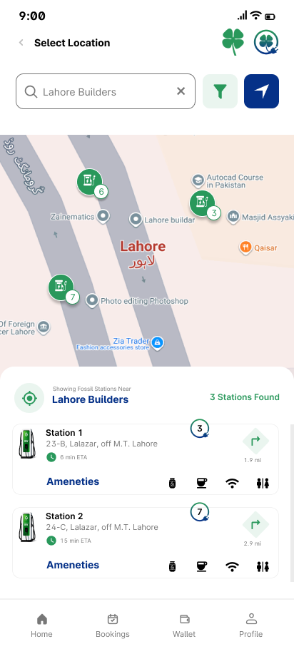
  
  
  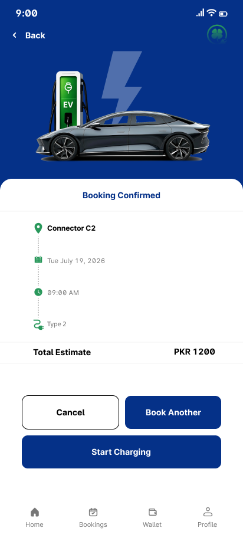
  
  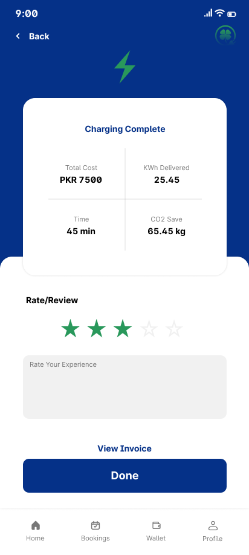
  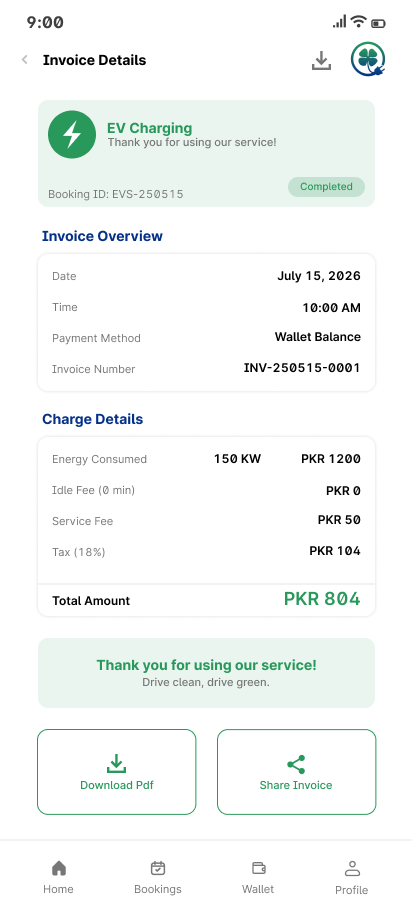

### Vehicles and payments

  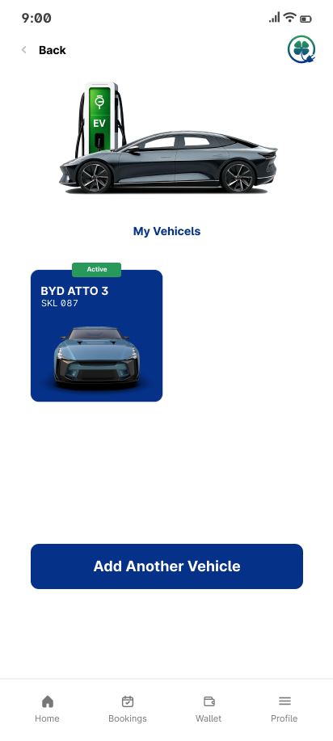
  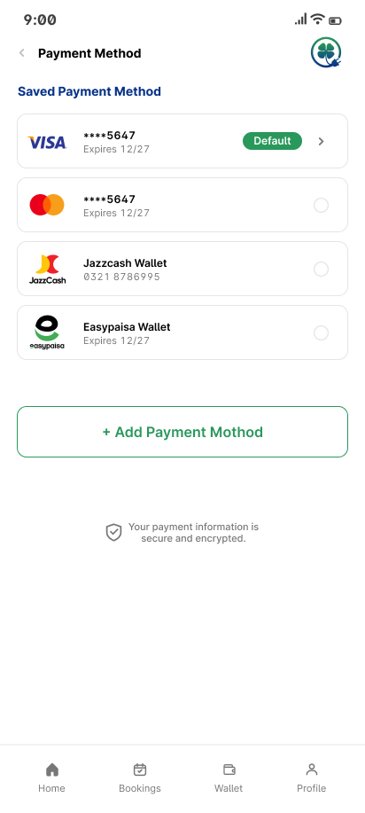

## Operations console

Same network, run from the web console. A partner login only sees that partner’s stations and settlements.

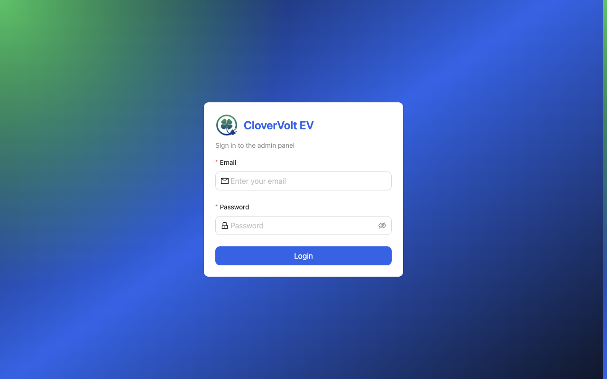

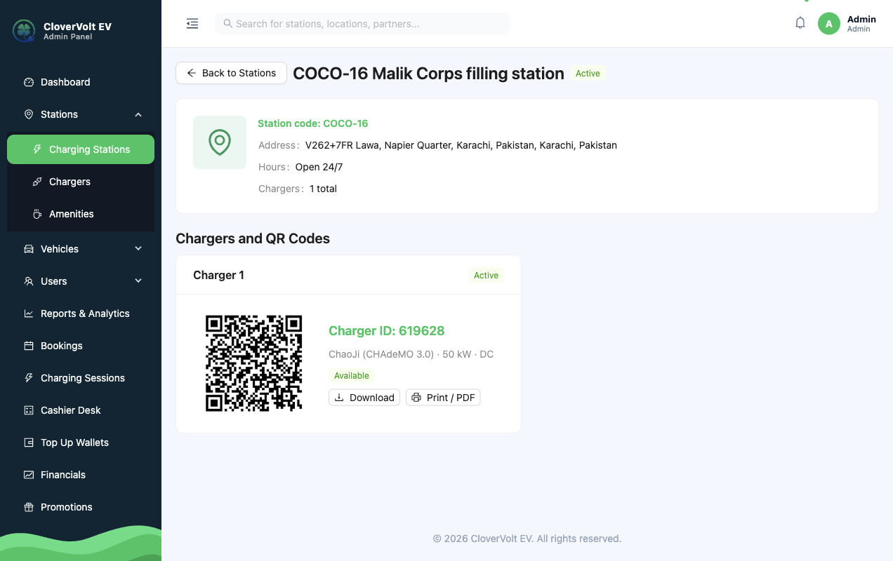

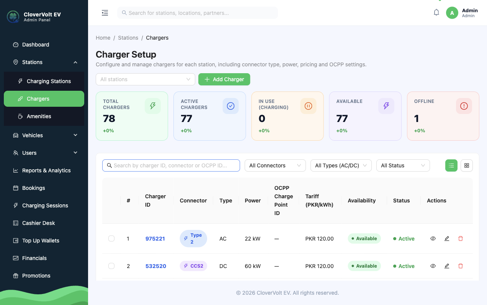

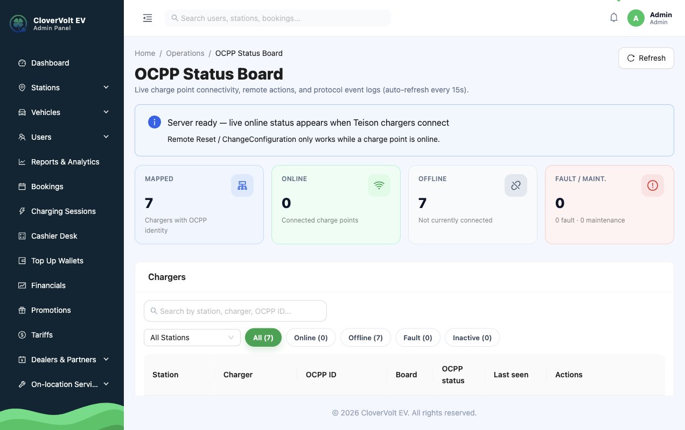

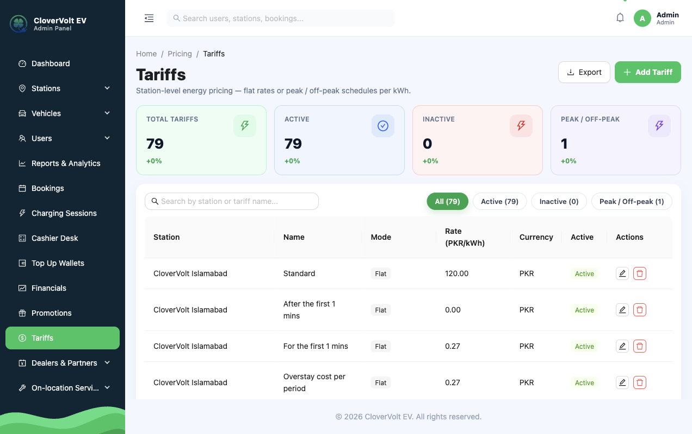

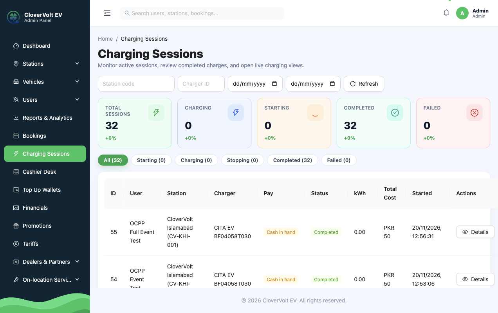

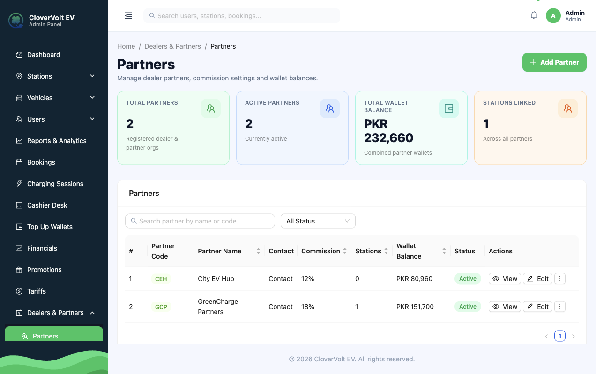

## How a charge moves

1. The charger stays connected to the server over OCPP.
2. The driver taps start. The server sends a remote start to that charger.
3. The charger accepts, opens a transaction, and begins sending meter readings.
4. Each meter reading is stored, priced from the station tariff, and pushed to that driver’s open session.
5. Stop closes the session and issues the bill.

## Stack

| Layer | Choice |
| --- | --- |
| Customer app | React Native |
| Operations console | React |
| API | Node.js |
| Data | PostgreSQL |
| Chargers | OCPP 1.6J |
| Live session | One WebSocket from the phone to the API |
| Auth | JWT, with Google and Apple sign-in |
| Money | Wallet, JazzCash, Easypaisa, and card |
