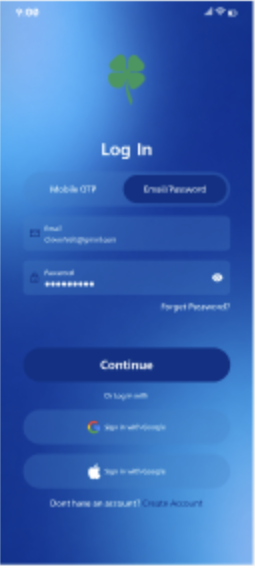
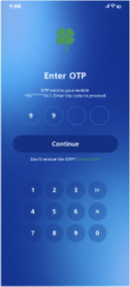

# CloverVolt

A case study of an EV charging product: a customer app for finding a charger and paying for a session, and an operations console for the people who run the network.

This repository is the write-up and the screens. It does not contain the application source.

Design source: the CloverVolt customer app in Figma.

## The product

CloverVolt is built for drivers in Pakistan who charge an EV away from home, and for the operators who own the chargers.

A driver should be able to open the app, see a station, start a charge, watch the session, and pay. An operator should be able to see which chargers are online, what they earned, and who their partners are.

The customer experience is a phone app. The operator experience is a web console. Both talk to the same backend. Chargers speak OCPP, so the app never talks to a charger directly.

## Customer app

The home screen is the front door. The driver sees a wallet balance, the nearest station, and the services on the network: EV charging, car wash, oil, tyres, and LPG.

  
  
  

Sign-in is built for how people in this market actually log in.

- Email and password
- Mobile number and a one-time code
- Google
- Apple

From the home screen the driver can start a charge with a 6-digit charger ID, an 8-digit booking ID, or a QR code on the charger. The app sends that request to the server. The server tells the charger to start. The phone does not open a connection to the charger.

While the car is charging, the phone keeps one live connection open. Energy, power, and the running cost arrive on that connection when the charger reports a new meter reading. The app does not call the API every few seconds to ask for the same numbers.

Payment uses the wallet already on the account, JazzCash, and Easypaisa. A finished session has a bill the driver can open.

## What the driver can do

| Area | What it covers |
| --- | --- |
| Account | Profile, vehicles, password, and saved payment methods |
| Stations | Map, distance, connector type, power, and amenities |
| Booking | A date and time on a specific connector, then check-in at the station |
| Charging | Remote start, live energy and cost, remote stop |
| Money | Wallet top-up, JazzCash, Easypaisa, card, and a receipt |
| On the go | Oil change, tyre fitting, and emergency help at a pinned location |
| At the station | Car wash packages, a time slot, and pick-up and drop-off |
| LPG | Cylinder pick-up at an outlet, or delivery to a pin inside the delivery area |

## Operations console

The same network is run from a web console. This Figma file is the customer app, so the console is described here rather than shown as a phone screen.

Operators use it to:

- Add stations, chargers, connectors, and the hours they are open
- Set a price per kWh, per minute, a session fee, an idle fee, and peak or off-peak rates
- Watch chargers move between available, charging, offline, and fault
- Start, stop, or reset a charger remotely, and read the OCPP log
- See live sessions, bookings, energy, and revenue
- Manage customers, roles, and permissions
- Run partner companies, their wallets, and settlements
- Publish coupons and moderate station reviews
- Take oil, tyre, emergency, car wash, and LPG orders, assign a technician, and update the status

A partner who logs in sees their own stations and their own settlements. They do not see another company's numbers.

## How a charge actually moves

1. The charger stays connected to the server over OCPP.
2. The driver taps start. The server sends a remote start to that charger.
3. The charger accepts, opens a transaction, and begins sending meter readings.
4. Each meter reading is stored, priced, and pushed to that driver's open session.
5. The driver taps stop. The server stops the charger, closes the session, and issues the bill.

If the charger is offline, the start is refused. The app does not pretend a session is running.

## Stack

| Layer | Choice |
| --- | --- |
| Customer app | React Native |
| Operations console | React |
| API | Node.js |
| Data | PostgreSQL |
| Chargers | OCPP 1.6J |
| Live session | A single WebSocket from the phone to the API |
| Auth | JWT, with Google and Apple sign-in |

## Status of the screens above

The three screens are taken from the CloverVolt Figma file. Home is a direct export of the frame. Login and OTP are the same frames, captured from the file. They show the product design, not a rebuilt mock.
